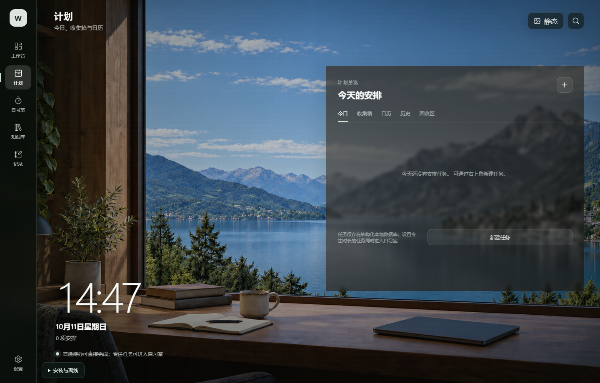
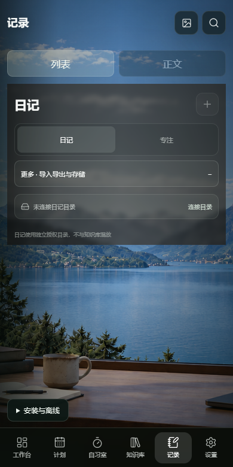

# 个人工作台

  
  
  
  
  
  
  
  

<b>安排今天的事，留出专注的时间。</b> 把任务、专注、知识与日记放在一个本地工作空间。

个人工作台是一款个人项目，提供 Windows 与 Android 体验版。任务和偏好保存在本机，知识库与日记按平台使用授权目录或应用内文件；可选的联网与 AI 能力有独立入口，不是云端自动同步服务。

> 当前版本 **v0.1.1**：移除记账模块，回归个人工作台。查看[本版说明](docs/RELEASE_v0.1.1.md)与[更新记录](CHANGELOG.md)。旧账目数据保留，不自动迁移到独立记账应用。

---

## 下载与安装

| 平台 | 安装包直链 | 大小 | 说明 |
| --- | --- | --- | --- |
| Windows x64 | [下载安装程序](https://github.com/lyq-05/personal-workbench/releases/download/v0.1.1/personal-workbench-v0.1.1-windows-x64-setup.exe) | 193.45 MiB | 面向 Windows 11 x64；未做代码签名 |
| Android | [下载 APK](https://github.com/lyq-05/personal-workbench/releases/download/v0.1.1/personal-workbench-v0.1.1-android.apk) | 42.51 MiB | 最低 API 24 / Android 7，旧版本系统未逐一实测；测试签名 |

[历史 Releases](https://github.com/lyq-05/personal-workbench/releases) · [SHA-256 校验文件](https://github.com/lyq-05/personal-workbench/releases/download/v0.1.1/SHA256SUMS.txt)

1. 升级前，在“设置 → 备份与恢复”导出备份；知识库、日记文件另外导出或备份目录。
2. Windows 下载后运行安装程序。未知发布者提示来自未签名状态，请先核对来源与校验值，不建议关闭系统安全保护。
3. Android 为下载/文件管理应用临时允许“安装未知应用”，安装 APK；完成后可关闭该权限。与旧测试版同包名、同签名时可尝试覆盖安装，不要先卸载。若提示签名冲突，停止安装并先备份，不要直接清除数据。
4. 本版尚未完成两平台的真实覆盖升级验收，重要数据务必留副本。

下载量是附件下载次数，不等于用户人数。大小使用 MiB（1 MiB = 1,048,576 字节）。

---

## 界面

截图来自本版构建的隔离数据预览，不含私人内容；手机图是 390 × 780 渲染预览，不是真机截图，原生权限与提醒效果以设备为准。

| 桌面计划 | 手机记录 |
| --- | --- |
|  |  |

---

## 它解决什么问题

- 将待办安排到今天，或先收进收集箱，避免任务分散。
- 从计划进入专注计时，完成后查看专注记录。
- 将知识资料和日记放进自己的本地文件空间，并通过搜索找回内容。
- 在手机上查看、记录，在电脑上阅读与整理；两端数据目前需自行导出迁移，不会自动同步。

## 功能

### 计划与专注

| 功能 | 说明 |
| --- | --- |
| 任务计划 | 今日、收集箱、日历、历史与回收区 |
| 任务提醒 | Android 系统通知与精确提醒授权；送达受系统后台策略影响 |
| 自习室 | 专注计时、任务切换和专注历史 |
| 回收区 | 删除后恢复或确认永久清空 |

### 知识与记录

| 功能 | 说明 |
| --- | --- |
| 知识库 | 文档浏览、编辑、目录与搜索 |
| 日记 | 按日期记录，文件导入导出 |
| 记录页 | 日记与专注；本版不再提供账目 |
| 备份恢复 | 导出结构化数据；正文文件需要另外备份 |

### 工作空间

| 功能 | 说明 |
| --- | --- |
| 场景与显示 | 静态/动态背景、字号与减少动态效果设置 |
| 模块设置 | 按需开启知识库、日记等能力 |
| Windows AI 助手 | 自行配置服务与密钥后使用；可能产生服务商费用，Android 不开放配置入口 |

---

## 权限与数据

| 项目 | 用途与边界 |
| --- | --- |
| 本机存储 | 保存任务、专注记录与偏好；清除应用数据或卸载可能丢失内容 |
| 文件目录/导出 | 用户主动授权或选择；知识库与日记文件不等同于 JSON 备份 |
| Android 通知、精确提醒 | 仅在使用任务提醒时按需授权；不代表系统一定显示横幅 |
| 后台耗电管理 | 部分手机需手动允许后台运行，才能稳定提醒；不是关闭省电模式就一定足够 |
| 支付识别权限 | 本版已移除支付通知监听和支付页面无障碍服务，不再采集支付信息 |
| AI / 联网内容 | 可选功能可能联网。使用 AI 时会向配置的服务提交相关输入；不要提交敏感内容，密钥不随公开仓库发布 |
| 历史账目 | 不删除旧数据库，继续兼容结构化备份；不再提供记账或审核入口，不自动同步到独立应用 |

## 常见问题

**为什么没有记账？** 记账已独立开发，个人工作台从 v0.1.1 起移除该模块。独立应用不是本仓库安装包的一部分。

**旧备份恢复后，会重新开启记账吗？** 不会。历史字段仍可保留，但旧的模块开关会归一为关闭。

**Android 后台提醒收不到怎么办？** 检查系统通知与精确提醒权限，以及手机的后台耗电管理。vivo / iQOO 可检查是否仍为“智能控制后台耗电”；用户在既有测试版改为“允许后台高耗电”后曾连续验证五次送达，但这不是所有机型和本版的送达保证。

**手机截图里的目录入口与我的 APK 不同？** 截图为渲染预览；浏览器、Windows 和 Android 的文件存储入口不同。以当前平台界面为准。

**JSON 备份能恢复全部文件吗？** 不能。知识库与日记正文应另外使用文件导出/文件夹备份，API 密钥也不要依赖业务备份保存。

**有没有自动更新、自动备份或两端同步？** 当前发布方式是手动下载安装；本次源码备份也是一次快照，不代表自动同步机制。

**本版已知问题？** Windows 打包后的完整界面冒烟测试在知识库紧凑布局检查失败：测试测得文件索引栏宽度为 0，未达到现有测试预期。尚未确认是布局行为还是测试预期需要调整，本次未修改知识库；使用窄窗口时请特别留意。

---

## 版本历史

| 版本 | 主题 |
| --- | --- |
| [v0.1.1](docs/RELEASE_v0.1.1.md) | 首次公开下载发布；移除记账，保留历史数据兼容 |
| [早期本地测试版](docs/HISTORY.md) | Android 提醒、返回行为、移动布局、回收区与旧自动记账探索 |

[完整更新记录](CHANGELOG.md) · [全部 Releases](https://github.com/lyq-05/personal-workbench/releases)

## 项目说明

这是个人开发的体验版，欢迎在 [Issues](https://github.com/lyq-05/personal-workbench/issues) 反馈问题，提交前请遮挡隐私。

此公开仓库仅发布说明、精选截图及安装包下载，**不公开开发源码**；源码在独立私有仓库备份。安装包包含运行所需代码，闭源不意味着安装包不可被分析。未授予源码开源许可。
